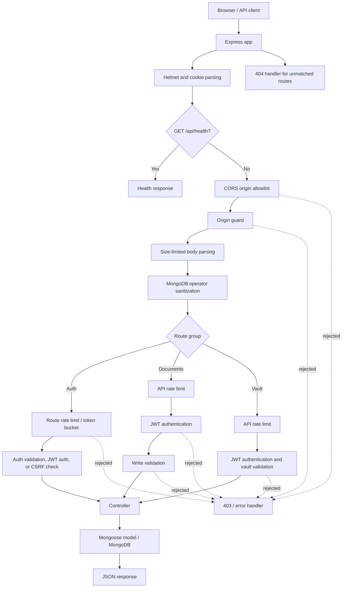

# Document Workshops


Document Workshops is a browser-based document editor with a React workspace, an Express API, and MongoDB persistence. Users can create standard documents or enable a client-side encryption vault for document titles, icons, and content.

The application includes a block editor, debounced saving, revision-based conflict detection, account authentication, optional Google sign-in, and client-side `.docx` and print/PDF export.

> **Security scope:** The vault is designed so the backend does not receive the vault passphrase, unwrapped master key, or plaintext of encrypted document fields. This is not a guarantee against a compromised browser, malicious client bundle, XSS, or compromised hosting. See [Security model and limitations](#security-model-and-limitations).

## Contents

- [Features](#features)
- [Technology stack](#technology-stack)
- [Architecture](#architecture)
- [API request flow](#api-request-flow)
- [Data flows](#data-flows)
- [Repository structure](#repository-structure)
- [Requirements](#requirements)
- [Local development](#local-development)
- [Configuration](#configuration)
- [API overview](#api-overview)
- [Security model and limitations](#security-model-and-limitations)
- [Troubleshooting](#troubleshooting)
- [Reporting issues](#reporting-issues)
- [Security terminology](#security-terminology)

## Features

- Rich block-based editor with headings, lists, callouts, code blocks, tables, and boards.
- Standard documents and an optional encrypted vault.
- Client-side AES-256-GCM field encryption with a per-document data-encryption key.
- Argon2id key derivation through WebAssembly, with a PBKDF2-SHA-256 fallback.
- Email/password authentication, email verification, and optional Google sign-in.
- Short-lived access tokens and rotating HttpOnly refresh-token cookies.
- Debounced document auto-save and optimistic revision checks.
- Guest workspace for trying the editor without creating an account.
- Client-side Word export and browser print-to-PDF.

## Technology stack

| Layer | Technologies |
|---|---|
| Web application | React 19, Vite 8, React Router |
| UI and state | Tailwind CSS 4, Redux Toolkit, React Context |
| API | Node.js, Express 5 (ES modules) |
| Database | MongoDB, Mongoose |
| Authentication | JSON Web Tokens, HttpOnly cookies, bcryptjs, Google Auth Library |
| Encryption | Web Crypto API (AES-GCM), Argon2id via `hash-wasm`, PBKDF2-SHA-256 fallback |
| Validation and protection | express-validator, Helmet, CORS, express-rate-limit, custom token buckets |
| Document output | `docx` client-side export and browser print styles |

## Architecture

```text
┌──────────────────────────────────────────────────────────┐
│ Browser: React + Vite                                    │
│ Editor, Redux state, authentication and vault contexts   │
│ Web Crypto API + Argon2id WASM                            │
└───────────────────────────┬──────────────────────────────┘
                            │ HTTPS / JSON REST API
                            │ Authorization: Bearer <access token>
                            │ HttpOnly refresh-token cookie
                            ▼
┌──────────────────────────────────────────────────────────┐
│ API: Node.js + Express 5                                  │
│ Authentication, validation, authorization, rate limits   │
│ Document revisions and opaque encrypted envelopes        │
└───────────────────────────┬──────────────────────────────┘
                            │ Mongoose
                            ▼
┌──────────────────────────────────────────────────────────┐
│ MongoDB                                                  │
│ User/session records, vault key metadata, documents      │
└──────────────────────────────────────────────────────────┘
```

The frontend and backend are separate applications with separate package manifests. The backend owns API validation, account/session operations, authorization, and persistence. The browser owns document editing, vault key derivation, encryption/decryption, and export.

Guest edits are held in the running application's state and are not automatically saved to an account or persistent browser storage. Register or sign in to use server-backed document persistence.

### API request flow

The health endpoint is intentionally handled before CORS and the origin guard so deployment health checks can reach it. Other requests follow the shared middleware chain, then branch into route-specific checks:



In concrete terms, authenticated document writes pass through origin/CORS checks, body parsing and sanitization, the document-group rate limiter, JWT authentication, request validation, controller-level ownership and revision checks, and MongoDB persistence. Authentication endpoints use their own route-specific limiters and validators; refresh and logout additionally use the CSRF origin guard. Unmatched routes return `404`, while middleware/controller errors are handled centrally.

### Main responsibilities

| Area | Responsibilities |
|---|---|
| `Frontend/src` | React application, editor, contexts, Redux store, API clients, crypto services |
| `Backend/server/src` | Express setup, routes, middleware, controllers, models, validation |
| `docs` | Additional project and security documentation |
| MongoDB | User accounts, refresh-token session metadata, document records, vault metadata |

## Data flows

### Standard document save

1. The editor updates its local document state.
2. The auto-save hook batches edits and waits for a short debounce interval (600 ms by default).
3. The document service sends a `PUT /api/documents/:id` request with the current revision in `If-Match`.
4. The backend authenticates the user, validates input, verifies document ownership, and checks the expected revision.
5. On success, the backend increments the revision and stores the document. On a stale revision it responds with `409 Conflict`; missing revision preconditions may be rejected with `428 Precondition Required`.
6. The editor adopts the saved revision or presents a conflict state if concurrent content differs.

### Encrypted document save

```text
Passphrase ── KDF + user-specific salt ──> KEK
                                             │ wraps
                                             ▼
                                      Master Key (MK)
                                             │ wraps
                                             ▼
                                Per-document Data Key (DEK)
                                             │ encrypts
                                             ▼
                           title, icon and content envelopes
```

1. In the browser, the passphrase and stored salt derive a key-encryption key (KEK).
2. The KEK unwraps the vault Master Key (MK). The MK is held as a non-extractable in-memory `CryptoKey`.
3. Each encrypted document has its own DEK, wrapped by the MK and cached only in memory.
4. Title, icon, and content are encrypted separately with AES-GCM using independent random 12-byte IVs. Additional authenticated data binds each encrypted field to its document ID, field name, and format version.
5. The frontend sends opaque ciphertext envelopes and the wrapped DEK. The backend validates envelope shape and persists the data without decrypting it.
6. The same revision check used for standard documents protects concurrent encrypted edits.

The current Argon2id profile uses 64 MiB of memory, three iterations, and parallelism of one. If Argon2id WASM is unavailable, the client uses PBKDF2-SHA-256 with 600,000 iterations. KDF parameters are stored with vault metadata and checked against client-side safety bounds.

Vault setup stores a salt, KDF parameters, and wrapped keys on the server. A recovery key independently wraps the MK and is shown once during setup; keep it somewhere safe. The server cannot recover the vault passphrase or decrypt the vault documents if both the passphrase and recovery key are lost.

### Authentication and refresh

1. Successful login returns a short-lived access JWT to the frontend. The frontend stores this access token in `localStorage` and attaches it to API requests.
2. A refresh JWT is set in an HttpOnly cookie; frontend JavaScript cannot read it.
3. When an access token expires, the API client makes one refresh request and retries the failed request. Concurrent expired requests wait on the same refresh operation.
4. Refresh tokens rotate within a session family. Reuse detection can revoke the affected session family.
5. Logout or session revocation clears local authentication state and requests a vault lock.

## Repository structure

```text
document-workshops/
├── Backend/
│   ├── .gitignore
│   └── server/
│       ├── .env.example
│       ├── eslint.config.js
│       ├── package-lock.json
│       ├── package.json
│       └── src/
│           ├── app.js
│           ├── server.js
│           ├── config/
│           │   ├── allowedOrigins.js
│           │   ├── config.js
│           │   ├── db.config.js
│           │   ├── db.indexes.js
│           │   └── document.aggregation.js
│           ├── controllers/
│           │   ├── auth.controller.js
│           │   ├── document.controller.js
│           │   └── vault.controller.js
│           ├── middleware/
│           │   ├── auth.middleware.js
│           │   ├── mongoSanitize.middleware.js
│           │   ├── originGuard.middleware.js
│           │   ├── rateLimiter.middleware.js
│           │   ├── tokenBucketGuard.middleware.js
│           │   └── validate.middleware.js
│           ├── models/
│           │   ├── document.models.js
│           │   └── user.models.js
│           ├── routes/
│           │   ├── auth.routes.js
│           │   ├── document.routes.js
│           │   └── vault.routes.js
│           ├── services/
│           │   └── email.service.js
│           ├── utils/
│           │   ├── tokenBucket.js
│           │   └── validation.js
│           └── validators/
│               ├── auth.validator.js
│               ├── document.validator.js
│               ├── envelope.validator.js
│               └── vault.validator.js
├── Frontend/
│   ├── .env.example
│   ├── .gitignore
│   ├── README.md
│   ├── eslint.config.js
│   ├── index.html
│   ├── package-lock.json
│   ├── package.json
│   ├── vercel.json
│   ├── vite.config.js
│   ├── public/
│   │   ├── favicon.svg
│   │   └── icons.svg
│   └── src/
│       ├── App.jsx
│       ├── config.js
│       ├── index.css
│       ├── main.jsx
│       ├── components/
│       │   ├── auth/
│       │   │   └── GuestRegisterModal.jsx
│       │   ├── common/
│       │   │   ├── ColorPickerDropdown.jsx
│       │   │   ├── ErrorBoundary.jsx
│       │   │   └── index.js
│       │   ├── layout/
│       │   │   └── sidebar/
│       │   │       ├── documentitems.jsx
│       │   │       └── sidebar.jsx
│       │   └── vault/
│       │       ├── GoogleConfirmButton.jsx
│       │       ├── RecoveryKeyModal.jsx
│       │       ├── VaultChangePassphraseModal.jsx
│       │       ├── VaultSetupModal.jsx
│       │       ├── VaultUnlockModal.jsx
│       │       └── index.js
│       ├── context/
│       │   ├── AuthContext.jsx
│       │   ├── EditorSettingsContext.jsx
│       │   └── VaultContext.jsx
│       ├── features/
│       │   └── editor/
│       │       ├── blocks/
│       │       │   ├── BoardBlock.jsx
│       │       │   ├── CalloutBlock.jsx
│       │       │   ├── CodeBlock.jsx
│       │       │   ├── TableBlock.jsx
│       │       │   └── index.js
│       │       ├── components/
│       │       │   ├── DocumentOutline.jsx
│       │       │   ├── DocumentRuler.jsx
│       │       │   ├── FindReplaceModal.jsx
│       │       │   ├── GoogleDocsToolbar.jsx
│       │       │   ├── PageFooter.jsx
│       │       │   └── ShortcutsModal.jsx
│       │       ├── hooks/
│       │       │   ├── useAutoSave.js
│       │       │   ├── useUndoRedo.js
│       │       │   └── useWordStats.js
│       │       ├── editorCanvas.jsx
│       │       ├── index.js
│       │       └── slashMenu.jsx
│       ├── pages/
│       │   ├── AuthPage.jsx
│       │   ├── index.js
│       │   ├── VerifyEmailPage.jsx
│       │   └── WorkspacePage.jsx
│       ├── services/
│       │   ├── crypto/
│       │   │   ├── encryption.js
│       │   │   ├── index.js
│       │   │   ├── kdf.js
│       │   │   ├── keyCache.js
│       │   │   ├── keys.js
│       │   │   ├── passphrase.js
│       │   │   └── vault.js
│       │   ├── api.js
│       │   ├── authServices.js
│       │   ├── documentServices.js
│       │   ├── docxExport.js
│       │   ├── index.js
│       │   ├── printService.js
│       │   ├── validation.js
│       │   └── vaultServices.js
│       └── store/
│           ├── slices/
│           │   ├── documentSlice.js
│           │   ├── editorSettingsSlice.js
│           │   └── uiSlice.js
│           └── index.js
└── docs/
    └── security-report.md
```

`components/` and `features/editor/` contain UI building blocks; `context/` coordinates authentication and vault lifecycles; `services/` contains API and crypto operations; and `store/` manages serializable interface/document state. The key cache is deliberately separate from Redux.

## Requirements

- Node.js `^20.19.0` or `>=22.12.0` (Vite requirement).
- npm.
- MongoDB connection string (local MongoDB or MongoDB Atlas).
- Google OAuth credentials only if Google sign-in is enabled.
- SMTP credentials for delivering email verification messages.

## Local development

Run the backend and frontend in separate terminals.

### 1. Configure and run the backend

```powershell
cd Backend\server
npm install
Copy-Item .env.example .env
```

Set at minimum `MONGO_URI`, `JWT_ACCESS_SECRET`, and `JWT_REFRESH_SECRET` in `Backend/server/.env`. The JWT secrets must be distinct and at least 32 characters long. Then start the API:

```powershell
npm run dev
```

The default API address is `http://localhost:3000`. Check `http://localhost:3000/api/health`.

### 2. Configure and run the frontend

```powershell
cd Frontend
npm install
Copy-Item .env.example .env
npm run dev
```

Vite serves the frontend at `http://localhost:5173` by default. See [Configuration](#configuration) for environment settings.

### Available scripts

| Application | Command | Purpose |
|---|---|---|
| Frontend | `npm run dev` | Start Vite development server |
| Frontend | `npm run build` | Create production build |
| Frontend | `npm run preview` | Preview the production build locally |
| Frontend | `npm run lint` | Run ESLint |
| Backend | `npm run dev` | Start API with Nodemon |
| Backend | `npm start` | Start API |
| Backend | `npm run lint` | Run ESLint |

## Configuration

Environment files are local configuration and must not be committed. Use the checked-in `.env.example` files as the source of truth for available variables.

### Backend (`Backend/server/.env`)

| Variable | Required | Description |
|---|---:|---|
| `MONGO_URI` | Yes | MongoDB connection string |
| `JWT_ACCESS_SECRET` | Yes | At least 32 characters; distinct from refresh secret |
| `JWT_REFRESH_SECRET` | Yes | At least 32 characters; distinct from access secret |
| `NODE_ENV` | No | `development`, `test`, or `production` |
| `PORT` | No | API port; defaults to `3000` |
| `CLIENT_URL` | Production | Comma-separated exact frontend origins allowed by CORS |
| `APP_REQUEST_TOKEN` | No | Optional additional request marker; see security note below |
| `JWT_ACCESS_EXPIRES_IN` | No | Access-token expiry; defaults to `10m` |
| `JWT_REFRESH_EXPIRES_IN` | No | Refresh-token expiry; defaults to `7d` |
| `GOOGLE_CLIENT_ID` | No | Google OAuth audience/client ID |
| `GOOGLE_CLIENT_SECRET` | No | Optional Google OAuth server credential |
| `EMAIL_HOST`, `EMAIL_PORT`, `EMAIL_SECURE` | No | SMTP connection settings |
| `EMAIL_USER`, `EMAIL_PASS`, `EMAIL_FROM` | No | SMTP authentication and sender settings |

In production, configure an exact `CLIENT_URL` and use HTTPS. The backend config validates required values and distinct JWT secrets at startup.

### Frontend (`Frontend/.env`)

| Variable | Required | Description |
|---|---:|---|
| `VITE_API_URL` | No | Backend origin; defaults to `http://localhost:3000` |
| `VITE_APP_REQUEST_TOKEN` | No | Optional value sent in the `X-App-Request` header |
| `VITE_GOOGLE_CLIENT_ID` | No | Google sign-in client ID |

Vite embeds variables prefixed with `VITE_` into the browser bundle. **Do not put secrets in frontend variables.** In particular, `VITE_APP_REQUEST_TOKEN` is visible to users and is not an authentication secret; the allowlisted Origin/Referer checks and normal authentication/authorization are the meaningful controls.

## API overview

All routes are prefixed with `/api`.

| Route group | Endpoints | Purpose |
|---|---|---|
| Health | `GET /health` | Service health check |
| Authentication | `POST /auth/register`, `/login`, `/google`, `/verify-email`, `/resend-verification`, `/refresh`, `/logout`; `GET /auth/me` | Account lifecycle and session handling |
| Documents | `GET /documents`, `GET /documents/:id`, `POST /documents`, `PUT /documents/:id`, `DELETE /documents/:id` | Authenticated document CRUD |
| Vault | `POST /vault/setup`, `GET /vault/meta`, `PUT /vault/meta` | Create/read/update encrypted vault key metadata |

Document endpoints require authentication and scope records to the current user. Vault endpoints require authentication. Request validators and rate limits are applied by route group; consult the route and middleware files for exact behavior.

## Security model and limitations

### Controls implemented

- Helmet response headers and a strict configured CORS origin allowlist.
- Origin/Referer checks for API requests; CSRF checks for refresh/logout routes.
- JWT authentication, HttpOnly refresh cookies, token rotation, session-family reuse detection, and secure production cookie settings.
- Login/register rate limits, additional in-memory token buckets for authentication, and request-body size limits.
- Request validation, MongoDB operator sanitization, document ownership checks, and server-side field/envelope validation.
- Revision preconditions for document updates to detect conflicting edits.
- Client-side vault encryption using Web Crypto AES-GCM and key derivation; the backend receives ciphertext envelopes for encrypted fields.
- The vault Master Key and document DEKs are kept outside Redux and browser persistent storage. The vault locks after an inactivity interval, clears the in-memory key cache, and clears decrypted document content from the application store.
- Production frontend headers are configured in `Frontend/vercel.json`; review these when adding third-party scripts, origins, or resources.

### Important limitations and operational risks

- **Not all documents are encrypted.** Standard documents are stored as plaintext in MongoDB. Vault encryption applies to title, icon, and content; cover-image references and operational metadata are not part of those encrypted fields.
- **Zero-knowledge is scoped to vault contents.** The server can still observe account data, document IDs, timestamps, revision numbers, ciphertext sizes, and request metadata such as IP addresses.
- **Client integrity is part of the trust model.** A compromised hosting provider, deployment pipeline, DNS, browser, or malicious script could capture passphrases or decrypted data. XSS and malicious browser extensions are also risks while the vault is unlocked.
- **The access JWT is stored in `localStorage`.** This supports session restoration but increases exposure if same-origin JavaScript is compromised. The refresh token is HttpOnly; the access token is not.
- **Passphrases cannot be reset by the server.** If the vault passphrase and recovery key are both lost, encrypted documents may be unrecoverable.
- **Key clearing is best effort.** JavaScript cannot guarantee secure memory erasure; locking removes references and cache entries but cannot promise physical memory wiping.
- **In-memory rate limits are per process.** They do not coordinate across multiple backend instances and may reset on restart. Production deployments with multiple instances should consider a shared rate-limit store.
- **The `X-App-Request` value is not a secret.** Since frontend values ship to the browser, it only acts as a secondary marker and must not be treated as protection against a determined client.
- **Cross-site cookie constraints apply.** Production refresh cookies use `SameSite=None; Secure`; browser privacy features can still restrict cross-site cookies. Deploy frontend and API on compatible domains, preferably under the same registrable domain, and verify on target browsers.
- **No independent security audit is claimed here.** See [docs/security-report.md](docs/security-report.md) for the project's documented verification scope and known gaps. Do not interpret internal tests or code review as formal certification.

## Troubleshooting

| Symptom | Checks |
|---|---|
| Backend exits during startup | Confirm `MONGO_URI`, both JWT secrets, and valid `NODE_ENV` are set in `Backend/server/.env`. |
| MongoDB connection fails | Check URI credentials, network/IP allowlisting, Atlas access, and DNS/connectivity. |
| Browser reports CORS or 403 errors | Verify the exact frontend origin (scheme, host, and port) is included in backend `CLIENT_URL`; do not use wildcard domains. Check `Origin`/`Referer` and optional app-request configuration. |
| Refresh does not persist in production | Verify HTTPS, cookie settings, API credentials mode, and frontend/API domain relationship; test Safari/iOS tracking prevention separately. |
| Email verification is not delivered | Configure SMTP variables and check backend logs and provider credentials. Email settings are optional in code, but verification mail cannot be delivered without them. |
| Google sign-in is unavailable | Set matching Google client IDs in backend and frontend, and configure allowed OAuth origins in Google Cloud. |
| Encrypted documents cannot be opened | Confirm the vault is unlocked and the correct passphrase/recovery key is being used. The server cannot decrypt or reset vault keys. |
| Document save shows conflict | Reload or compare the latest server version before overwriting; conflicts indicate the saved revision changed since the editor loaded it. |
| Requests are rate limited | Wait for the indicated retry interval. In-memory token-bucket state is process-local. |

## Reporting issues

Before reporting a problem:

1. Search existing project issues and confirm the behavior can be reproduced.
2. Include steps to reproduce, expected and actual behavior, browser/OS, and whether the issue affects development or production.
3. Include relevant sanitized error messages and request status codes. Redact email addresses, document contents, access tokens, cookies, recovery keys, and all environment values.
4. For security-sensitive vulnerabilities, do not publish exploit details or sensitive user data in a public issue. Use a private reporting channel provided by the repository maintainers.

## Security terminology

| Term | Meaning in this project |
|---|---|
| **E2EE (end-to-end encryption)** | Document encryption and decryption happen in the user's browser; the server stores encrypted envelopes for vault-protected fields. |
| **Zero-knowledge** | A design goal that the service does not possess the vault passphrase or unwrapped document keys. It does not hide all metadata or protect a compromised client. |
| **KDF (key derivation function)** | Converts a passphrase and salt into key material. This project uses Argon2id (64 MiB, three iterations, parallelism one) where available and PBKDF2-SHA-256 (600,000 iterations) as fallback. |
| **KEK (key-encryption key)** | Derived key that wraps/unwraps the vault Master Key. |
| **MK (Master Key)** | Random vault root key that wraps each document DEK and can be wrapped by the passphrase-derived KEK or recovery key. |
| **DEK (data-encryption key)** | Per-document key used to encrypt that document's sensitive fields. |
| **Envelope** | Stored ciphertext representation, including version, IV, and ciphertext; document key wrapping is stored separately. |
| **IV / nonce** | Per-encryption random value used by AES-GCM. This implementation uses a 12-byte IV for each encrypted field. It is not a secret and must not be reused with the same key. |
| **AAD (additional authenticated data)** | Non-secret context authenticated by AES-GCM. Here it binds ciphertext to a document ID, field name, and format version. |
| **JWT** | Signed token used to represent authenticated access. Access and refresh tokens use separate signing secrets and lifetimes. |
| **CSRF** | Cross-site request forgery: unwanted authenticated actions induced from another site. Origin checks and cookie/request handling mitigate this risk. |
| **IDOR** | Insecure direct object reference: access to another user's resource by changing an identifier. Document queries are scoped to the authenticated owner. |
| **Optimistic concurrency** | Updates include the revision the client expects; stale writes are rejected rather than silently overwriting newer changes. |
