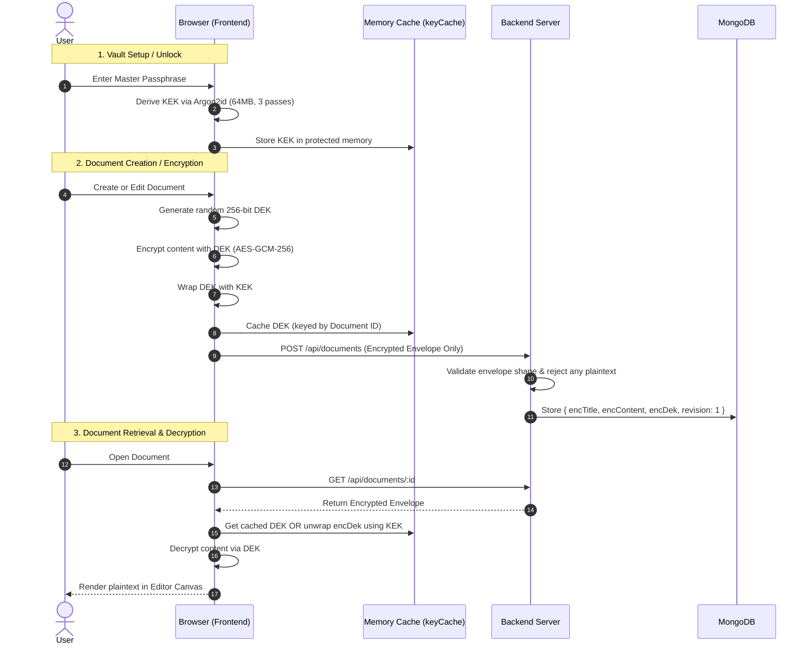

# Document Workshops

[](SECURITY.md)
[]()
[]()
[]()

**Document Workshops** is a modern, web-based collaborative document editor that mirrors the rich text editing experience of Microsoft Word and Google Docs, backed by a **Zero-Knowledge, End-to-End Encrypted (E2EE) Vault** and defense-in-depth security.

Built with a performance-first tech stack, it features block-based document editing, dynamic canvas page layouts, auto-saving with optimistic concurrency conflict detection, and client-side encryption where documents are encrypted and decrypted entirely inside the browser.

---

## 🚀 Key Features

### 🔐 Zero-Knowledge Encrypted Vault
- **Client-Side Cryptography**: Your master passphrase never leaves your device. Keys are derived in-browser using **Argon2id** (with WebAssembly acceleration) and fallback to **PBKDF2-HMAC-SHA-256** (600,000 iterations).
- **Envelope Encryption**: Each document receives an independently generated 256-bit AES-GCM Data Encryption Key (DEK). Titles, icons, and document blocks are encrypted before network transmission.
- **256-Bit Recovery Keys**: Emergency recovery codes allow secure vault recovery without central authority or password resets.
- **In-Memory Key Safety**: DEKs are never saved in local storage or Redux state. They reside in a protected, ephemeral key cache that automatically purges on vault lock, logout, or session termination.
- **15-Minute Inactivity Auto-Lock**: Automatic vault lock on idle timeout with automatic memory sanitization and clipboard wipe after 60 seconds.

### 📝 Document Editing & Experience
- **Rich Block Editing**: Headings, styled text, lists, code blocks with syntax highlighting, callout banners, data tables, and kanban boards.
- **Dynamic Layouts**: Switch between A4, Letter, Legal, and Full Width page formats, customize margins with an interactive ruler, and switch canvas visual themes.
- **Optimistic Concurrency & Conflict Protection**: Strict atomic revisions (`revision` / `If-Match`) prevent concurrent overwrite data loss, presenting conflict resolution alerts when documents are updated across sessions.
- **Export & Print**: Export directly to standard Microsoft Word (`.docx`) files or print cleanly formatted pages stripped of UI chrome.

### 🛡️ Defense-in-Depth Authentication
- **Dual JWT with Family Rotation**: Short-lived access tokens paired with `HttpOnly` refresh tokens that track rotation families (`fam`). Replayed refresh tokens instantly trigger revocation of the entire token family.
- **Origin Guard CSRF Shield**: Mutating endpoints enforce matching `Origin` / `Referer` headers against allowed application origins.
- **Continuous Token Bucket & Split Rate Limiting**: Strict rate limiting (10 req/15 min) and token bucket guards on sensitive auth endpoints, paired with generous limits (60 req/15 min) for silent background refreshes.
- **Google OAuth Linking**: Secure Google Sign-In with audience validation, verified email enforcement, and explicit password linking protection.

---

## 🛠️ Architecture & Tech Stack

```
┌─────────────────────────────────────────────────────────────┐
│                       Frontend (Vite)                       │
│  React 18  │  Redux Toolkit  │  Tailwind CSS  │  Web Cryptography │
│  Argon2id  │  AES-GCM-256    │  keyCache.js   │  AutoSave Hook    │
└──────────────────────────────┬──────────────────────────────┘
                               │ HTTPS / JSON Envelopes
                               │ (Ciphertext + IV + Tag)
┌──────────────────────────────▼──────────────────────────────┐
│                    Backend (Node / Express)                 │
│  Origin Guard  │  Token Bucket  │  Strict Rate Limiter      │
│  Envelope Validators  │  fam Token Rotation  │  MongoSanitize │
└──────────────────────────────┬──────────────────────────────┘
                               │ Mongoose Driver
┌──────────────────────────────▼──────────────────────────────┐
│                      Database (MongoDB)                     │
│  Encrypted Envelopes (No Plaintext) │ User & Vault Metadata │
└─────────────────────────────────────────────────────────────┘
```

### Frontend
- **Framework**: React 18 with hooks and context providers (`AuthContext`, `VaultContext`, `EditorSettingsContext`).
- **State Management**: Redux Toolkit for global document collections, keeping keys completely out of state.
- **Cryptography**: Web Crypto API (SubtleCrypto) + `@noble/hashes` for Argon2id, AES-GCM-256 envelope encryption.
- **Build & Test**: Vite, Tailwind CSS, Lucide icons, Vitest.

### Backend
- **Runtime**: Node.js (v18+) and Express.
- **Database**: MongoDB with Mongoose schemas and compound indexes.
- **Security Middleware**: Helmet, CORS origin restriction, Origin Guard CSRF defense, `express-mongo-sanitize`, dual rate-limiters, continuous token bucket guards.
- **Test Suite**: Native Node.js test runner with `mongodb-memory-server` for fully isolated in-memory test execution.

---

## 🔄 Cryptographic Flow



---

## 🚦 API Endpoints

All endpoints are mounted under `/api`:

### Authentication (`/api/auth/*`)
| Method | Endpoint | Description | Rate Limit |
|--------|----------|-------------|------------|
| `POST` | `/auth/register` | Register new user account | Strict (10/15m) + Bucket |
| `POST` | `/auth/login` | Authenticate with email/password | Strict (10/15m) + Bucket |
| `POST` | `/auth/google` | Authenticate or link with Google ID token | Strict (10/15m) + Bucket |
| `POST` | `/auth/verify-email` | Verify email address token | Strict (10/15m) |
| `POST` | `/auth/resend-verification` | Resend verification email | Strict (10/15m) |
| `POST` | `/auth/refresh` | Silently rotate access token using HttpOnly cookie | Generous (60/15m) |
| `POST` | `/auth/logout` | Revoke session and clear cookies | Generous (60/15m) |
| `GET`  | `/auth/me` | Fetch active user session | Generous (60/15m) |

### Zero-Knowledge Vault (`/api/vault/*`)
| Method | Endpoint | Description |
|--------|----------|-------------|
| `GET`  | `/vault/meta` | Fetch encrypted vault configuration & salt |
| `POST` | `/vault/setup` | Initialize vault parameters and wrapped keys |
| `PUT`  | `/vault/meta` | Rotate passphrase, re-wrap master keys, archive historical keys |

### Documents (`/api/documents/*`)
| Method | Endpoint | Description |
|--------|----------|-------------|
| `GET`    | `/documents` | List user documents (metadata & encrypted summaries) |
| `GET`    | `/documents/:id` | Fetch full document content (plaintext or encrypted envelope) |
| `POST`   | `/documents` | Create document (enforces envelope if vault enabled) |
| `PATCH`  | `/documents/:id` | Update document (mandatory `revision` / `If-Match`, returns 409 on conflict) |
| `DELETE` | `/documents/:id` | Delete document |

---

## ⚡ Getting Started Locally

### Prerequisites
- **Node.js**: v18.0.0 or higher
- **MongoDB**: Local MongoDB instance or Atlas connection string

### 1. Clone & Configure
```bash
git clone https://github.com/AdityaUpadhyay2610/document-workspace.git
cd document-workshops
```

### 2. Backend Setup
```bash
cd Backend/server
npm install
cp .env.example .env
```
*Review `.env` and configure your `MONGODB_URI`, `JWT_ACCESS_SECRET` (min 32 chars), `JWT_REFRESH_SECRET` (min 32 chars, distinct from access secret), and `CLIENT_URL`.*

Start backend in development mode:
```bash
npm run dev
```

### 3. Frontend Setup
```bash
cd ../../Frontend
npm install
cp .env.example .env
```
*Configure `VITE_API_URL=http://localhost:5000` in `.env`.*

Start frontend in development mode:
```bash
npm run dev
```

Open [http://localhost:5173](http://localhost:5173) in your browser.

> [!NOTE]
> **Safari & iOS Compatibility (Production Single Custom Domain)**:  
> Safari's Intelligent Tracking Prevention (ITP) restricts third-party cross-origin cookies between different domains (for example, `your-app.vercel.app` and `your-api.onrender.com`). For `HttpOnly` refresh cookies to persist seamlessly across sessions on Safari and iOS devices in production, configure a custom root domain for both services (e.g. `app.yourdomain.com` for the frontend and `api.yourdomain.com` for the backend).

---

## 🧪 Testing

### Backend Security & Integration Tests
Runs 34 tests covering IDOR, rate limiting, vault invariants, envelope bypass rejection, atomic revisions, and token rotation against an in-memory MongoDB:
```bash
cd Backend/server
npm test
```

### Frontend Crypto Unit Tests
Runs 35 unit tests validating Argon2id derivation, key wrapping, recovery flows, passphrase entropy, and memory cache lifecycle:
```bash
cd Frontend
npm test -- --run
```

---

## 🔒 Security Policy
For details on our threat model, key derivation parameters, and responsible vulnerability disclosure, please refer to [SECURITY.md](SECURITY.md).

---

## 📄 License
This project is licensed under the MIT License.
